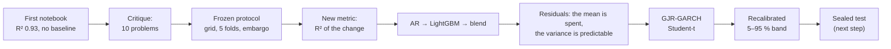
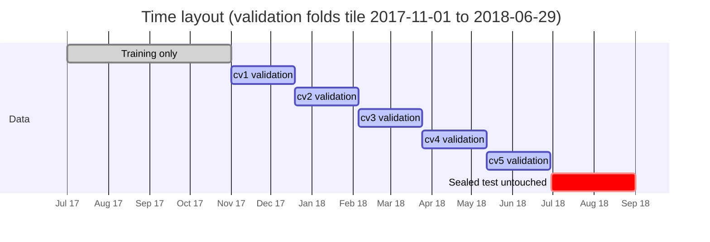

# ⚡ Progress log: forecasting geostationary electron flux (ISRO GRASP)

> [!NOTE]
> **Status, 26 Nov 2026: v1.0.** Validation results are complete. The **sealed test window has not been run yet.**
> This file tells the story of the project: what was done, **the mathematics behind each step, and why each step was taken**, including the wrong turns.
> Every number comes from a notebook output. Where a reason is an interpretation and not a tested result, the text says so.

**Contents**

1. [Summary](#1-summary)
2. [Timeline](#2-timeline)
3. [Notation and the metric](#3-notation-and-the-metric)
4. [Where it started, and why everything was rebuilt](#4-where-it-started-and-why-everything-was-rebuilt)
5. [The frozen protocol](#5-the-frozen-protocol)
6. [Baselines, and why the metric changed](#6-baselines-and-why-the-metric-changed)
7. [What the series looks like (diagnostics)](#7-what-the-series-looks-like-diagnostics)
8. [The point forecast](#8-the-point-forecast)
9. [The variance track (GARCH family)](#9-the-variance-track-garch-family)
10. [The probabilistic forecast: point + variance](#10-the-probabilistic-forecast-point--variance)
11. [Extra studies (questions raised by the results)](#11-extra-studies-questions-raised-by-the-results)
12. [The pivot log](#12-the-pivot-log)
13. [Findings](#13-findings)
14. [Disclosures and protocol amendments](#14-disclosures-and-protocol-amendments)
15. [Engineering incidents and fixes](#15-engineering-incidents-and-fixes)
16. [Open items](#16-open-items)
17. [Reading guide and file map](#17-reading-guide-and-file-map)
- [References](#references)

---

## 1. Summary

**Goal.** Forecast electron flux at geostationary orbit from the ISRO GRASP payload, from 5-minute data (2017-07-01 to 2018-09-01), **30 min, 45 min and 1 h ahead**, with an honest uncertainty band. The tools are finance-style time-series methods: ridge autoregression, gradient boosting and GARCH.

**The path in one picture.**

**Headline results** (share of the log-flux *change* explained, R²_Δ, pooled over the five validation folds; persistence scores 0 by construction):

| Model | 30 min | 45 min | 1 h |
|---|---|---|---|
| Seasonal baseline (clock only) | 0.075 | 0.113 | 0.150 |
| Ridge AR (`ar_final`) | 0.106 | 0.155 | 0.200 |
| LightGBM blend (best) | **0.149** | **0.200** | **0.246** |

- **Point forecast.** Positive in every fold; the gain is real (placebo tests drop it to about zero).
- **Variance forecast.** A GJR-GARCH model beats EWMA, rolling windows and constant variance at every horizon (all Diebold–Mariano p ≈ 0).
- **Probabilistic forecast.** The recalibrated 90 % band breaches 9.5 % / 10.0 % / 10.0 % of the time (target 10 %) and the direction is right 68.9 % / 72.3 % / 74.8 % of the time (about 51 % for always guessing the commoner direction).
- **What did not survive the rebuild.** "Proton flux helps predict electron flux", "the 24 h cycle explains 62–64 % of the variance" as a level predictor, and every R² on the log level quoted without a persistence baseline.
- **Biggest open weakness.** The recalibrated band is unstable fold by fold (breach rate 7.2 % to 13.2 %), and its breaches cluster in time.

---

## 2. Timeline

| When | Phase | What happened |
|---|---|---|
| Mid 2026 | A. First notebook | 425 daily files parsed; spikes cleaned; 70/15/15 split with a 24 h embargo; Granger, VAR, Fourier, GARCH, Hawkes, cointegration, MLP and LSTM |
| 4 Sep 2026 | A2. Retrospective | Full audit of the 87-cell notebook: what worked, what failed, what looked promising |
| 20 Nov 2026 | B. Critique | First repository bundle reviewed; ten problems found; decision to rebuild |
| 20–24 Nov 2026 | C–F. Rebuild | Frozen protocol, regular grid, baselines, diagnostics, AR, LightGBM, blend |
| 24 Nov 2026 | G. Variance track | GARCH-family Steps 1–5: distribution, order, structure, benchmarks, normal vs t |
| 24–25 Nov 2026 | H. Probabilistic forecast | Blend + GARCH 5–95 % band, interactive figures, direction and breach diagnostics |
| 25 Nov 2026 | I. Extra studies | Rolling-band jumps, Hawkes, seasonality tests, XGBoost robustness check |

---

## 3. Notation and the metric

### 3.1 Target and horizon

Let $x_t$ be the flux in 5-minute slot $t$ and $y_t=\ln x_t$ its logarithm. For a horizon of $H$ slots the quantity to forecast is the **log change**

$$
\Delta_t^{H}=y_{t+H}-y_t,\qquad H\in\{6,\,9,\,12\}\ \text{slots}=\{30,\,45,\,60\}\ \text{min}.
$$

*Why logs?* Flux spans orders of magnitude (median about 21 in the calmest fold, storm peaks above 1000). On the log scale a given **ratio** is the same size at any flux level, and multiplicative effects become additive.

*Why the change?* The flux is extremely sticky: the best simple guess for "an hour from now" is "now". Forecasting $\Delta$ removes that free part and leaves only what a model must actually *learn*.

### 3.2 R² of the change, and skill over persistence

A forecast $\hat\Delta$ has squared error $\mathrm{SSE}=\sum_t(\Delta_t-\hat\Delta_t)^2$. **Persistence** says "no change", $\hat\Delta=0$, so $\mathrm{SSE}_{\text{pers}}=\sum_t\Delta_t^2$. Define

$$
R^2_\Delta=1-\frac{\sum_t(\Delta_t-\hat\Delta_t)^2}{\sum_t(\Delta_t-\bar\Delta)^2},\qquad
\text{skill}=1-\frac{\mathrm{SSE}_{\text{model}}}{\mathrm{SSE}_{\text{pers}}}.
$$

The mean change $\bar\Delta$ is close to zero, so the two numbers agree to the digits reported. **Persistence scores exactly 0**, so any positive value is real information, and **1 means a perfect forecast**.

### 3.3 Why the level metric hides everything (a short derivation)

The usual R² on the log level is $R^2_{\log}=1-\mathrm{SSE}/\mathrm{SST}$ with $\mathrm{SST}=\sum_t(y_{t+H}-\bar y)^2$. The same rows give the same $\mathrm{SST}$ for every model, so

$$
1-R^2_{\log}(\text{model})=\frac{\mathrm{SSE}_{\text{model}}}{\mathrm{SST}}
=\underbrace{\frac{\mathrm{SSE}_{\text{pers}}}{\mathrm{SST}}}_{1-R^2_{\log}(\text{persistence})}\cdot
\underbrace{\frac{\mathrm{SSE}_{\text{model}}}{\mathrm{SSE}_{\text{pers}}}}_{1-\text{skill}} .
$$

**Worked example, 45 min, `ar_final`:** persistence leaves $1-0.9505=0.0495$ of the level unexplained; skill is $0.1547$; so the model leaves $0.0495\times(1-0.1547)=0.0418$, which is $R^2_{\log}=0.9582$.
A **15.5 % cut in the error** shows up as a move from 0.9505 to 0.9582. That is why the log-level R² cannot tell a good model from a trivial one at short horizons, and why this project reports $R^2_\Delta$ as its headline.

> [!TIP]
> Three R² values are always shown. **$R^2_\Delta$** separates models. **$R^2_{\log}$** is dominated by the level carried forward, so every model scores 0.93–0.97. **$R^2_{\text{raw}}$** (flux without logs) is dominated by the largest events.

---

## 4. Where it started, and why everything was rebuilt

**The first notebook (BAH 2026, problem statement 12).** The brief: predict energetic electron flux 30–45 min ahead and give a reasonable forecast at 6 h and 12 h. The first notebook parsed 425 daily files (about 122,400 rows), interpolated isolated one-sample spikes that were judged instrument artefacts (excess kurtosis fell from 232 to 81), used a chronological 70/15/15 split with a 24 h embargo, and then tried Granger tests, VAR, Fourier/LOESS decomposition, GARCH, Hawkes processes, an electron–proton spread model, an MLP and an LSTM.
Its headline claims were VAR + GARCH with $R^2=0.93$ at 30–45 min, a simple structural model beating all complex models at 6–12 h, and Hawkes and cointegration as honest negative results.

**The critique.** The first repository bundle was reviewed critically. Ten problems were found, and they are the reasons for everything that follows:

1. **No persistence baseline.** The "0.93" at 30–45 min had nothing to be compared with. The rebuild shows persistence alone scores 0.95–0.97 on the log level at these horizons.
2. **Deep models lost where it mattered.** At 6 h their raw-flux R² was 0.595 (MLP) and 0.593 (LSTM) against 0.720 for the structural model; they won only in log space.
3. **The per-percentile R² table was misleading.** Grouping rows by the true value gives negative R² by construction.
4. **The validation set was no longer clean.** It had set the interval calibration scale (so 95 % coverage was guaranteed) and had been used to choose between model versions.
5. **Small sample.** Validation and test each covered about two months, with few storms, no confidence intervals and one seed per network.
6. **No regular time grid.** Lags and targets shifted by *row*, so "6 h ahead" was not 6 h around gaps.
7. **The scoring target had been edited.** Validation targets were the cleaned series; the test set was not cleaned.
8. **The LSTM-vs-MLP comparison was confounded** (7 raw channels against 44 engineered features).
9. **No ablation of the 44 features**, and the Hawkes parameters were hard-coded.
10. **Thin scope against the brief.**

**Decision.** Do not patch the old notebook. Re-run everything under one frozen protocol with proper baselines, so each result can be defended.

---

## 5. The frozen protocol

Everything lives in three files (`core.py`, `runio.py`, `evalkit.py`; copies are in `src/`).

### 5.1 A regular grid

The data is snapped to a **regular 5-minute grid of 122,976 slots** (2017-07-01 00:05 to 2018-09-01 00:00). Missing slots are kept as NaN and never skipped, so a target 6 steps ahead is exactly 30 minutes ahead.

| Item | Count |
|---|---|
| Slots with any missing value | 1,168 (65 missing runs, longest 573 steps) |
| Outage slots / near-outage slots | 1,090 / 291 |
| Isolated spike slots flagged | 20 |
| Scorable slots | 121,507 |

### 5.2 Five expanding folds, a 24 h embargo, and a sealed test

With $t_0$=2017-11-01 and $t_5$=2018-06-29, the fold edges are equally spaced and rounded to the hour:

$$
e_k=\operatorname{round}_{60\,\text{min}}\!\Big(t_0+\tfrac{k}{5}\,(t_5-t_0)\Big),\qquad k=0,\dots,5 .
$$

Fold $k$ is validated on $[e_{k-1},e_k)$ and trained on **everything before it** (expanding window). Two rules prevent leakage through overlapping targets:

$$
\text{train row } t:\quad t+H\le e_{k-1}-24\,\text{h},\qquad\qquad
\text{validation row } t:\quad t\ge e_{k-1}\ \text{ and }\ t+H<e_k .
$$

*Why a 24 h embargo?* A training target must be complete a full day before validation starts. The features look back up to 3 days (the `dev864` block) and the daily cycle makes "yesterday" informative, which is why the gap is a full day. `cv5` is identical to the "static split" used earlier.

*Why five folds instead of one?* One two-month window contains a handful of storms and cannot show stability. The folds differ a lot in difficulty:

| Fold | Median flux | Share of flux above 1000 | Variance of log flux |
|---|---|---|---|
| cv1 | 45.3 | 3.8 % | 2.59 |
| cv2 | 21.7 | 0.0 % | 1.62 |
| cv3 | 21.1 | 2.6 % | 3.05 |
| cv4 | 130.6 | 12.5 % | 3.09 |
| cv5 | 60.0 | 6.3 % | 2.67 |

Results are therefore always reported **per fold and pooled**. The **sealed test** (2018-06-30 to 2018-09-01) is reserved for one final run with every choice frozen.

### 5.3 Flags that choose rows, never inputs

Three flags describe data quality: **outage** (a missing run of at least 6 slots), **near-outage** (within 12 slots of one) and **spike** (up by more than 2.5 in log and straight back down). They look at the future, so they are named `*_noncausal` and are used **only to decide which rows are trained and scored**, never as model inputs. The one flag that *is* a model input, `stale_steps` (slots since the last real observation), is causal.

### 5.4 Leakage tests, stated as maths

A feature builder $\varphi$ is **causal** if $\varphi_s(x)$ depends only on $x_u$ for $u\le s$. The test perturbs the future of the input after a cut point $s$ (scale it, replace it by NaN, shuffle, fill, crash, hold) and requires that **every feature at or before $s$ is unchanged**. A **fit-independence test** perturbs the validation period and requires that the *fitted model* does not change. To make sure the tests can fail, a **gallery of six deliberately leaky builders** (centred rolling mean, interpolation across the future, back-fill, global standardisation, a lead, a future-based mask) must all be caught, and **four clean builders must pass**.

### 5.5 Tools used throughout

**Diebold–Mariano test.** To compare two forecasts, take the loss difference $d_t=e_{t,\text{base}}^2-e_{t,\text{model}}^2$ (positive means the model is better) and

$$
\mathrm{DM}=\frac{\bar d}{\sqrt{\widehat{\mathrm{LRV}}/T}},\qquad
\widehat{\mathrm{LRV}}=\hat\gamma_0+2\sum_{k=1}^{q}\Big(1-\frac{k}{q+1}\Big)\hat\gamma_k ,
$$

with a Bartlett (Newey–West) long-run variance and $q$ equal to one day of rows. *Why HAC?* Forecasts made every 5 min for horizon $H$ share $H-k$ of their $H$ underlying 5-min increments at lag $k$, so even a **perfect** forecaster has residual autocorrelation about $1-k/H$ for $k<H$. A plain $t$-test would be wildly over-confident.

**Day-block bootstrap.** Resample whole *days* with replacement, recompute the skill, and take the 2.5th and 97.5th percentiles. Whole days are used because errors within a day are strongly dependent.

**Placebo test.** Destroy the link between history and target while keeping everything else (the marginal distributions and the time of day), refit, and compare with the real fit. With $B$ placebo draws,

$$
p=\frac{1+\#\{b:\ \text{skill}_b^{\text{placebo}}\ge\text{skill}^{\text{real}}\}}{B+1},\qquad B=30\ \Rightarrow\ p_{\min}=\tfrac1{31}=0.0323 .
$$

---

## 6. Baselines, and why the metric changed

Three baselines were built before any model:

- **Persistence:** $\hat y_{t+H}=y_t$.
- **24 h seasonal naive:** $\hat y_{t+H}=y_{t+H-288}$ (the same time yesterday).
- **Persistence + seasonal delta:** $\hat y_{t+H}=y_t+\bar\Delta_{b(t)}$, where $\bar\Delta_b$ is the mean change over training rows whose origin falls in the 30-minute time-of-day bin $b$ (this is the definition used from the second run on; see disclosure 2).

**First baseline run** ($R^2_{\log}$, pooled):

| Horizon | Persistence | 24 h seasonal naive | Persistence + seasonal delta |
|---|---|---|---|
| 45 min | 0.950 | 0.598 | 0.916 |
| 6 h | 0.454 | 0.598 | 0.681 |
| 12 h | −0.013 | 0.594 | 0.512 |

**What this taught us.**

- At 45 min, "repeat the last value" already scores 0.95, so the level metric cannot rank short-horizon models. → **Pivot 2: score the change** (section 3).
- At 6–12 h persistence fails and the daily pattern matters.
- In the first run the seasonal-delta baseline lost to persistence at 45 min (0.916 vs 0.950). The version used afterwards beats it (0.9561 vs 0.9505), which is an amendment to disclose.

**A negative control: hour-of-day climatology.** Predicting $\hat y_{t+H}=\text{mean of } y$ at the same hour in training scored $R^2_{\log}=-0.079$ at 45 min. At 6 h the bias per fold was $-1.11,\,-1.58,\,-0.94,\,+0.53,\,-0.14$, because the *level* of the daily curve shifts between folds. With the bias removed, $R^2$ would have been 0.22, 0.23, 0.10, 0.17, 0.14.

> [!IMPORTANT]
> **The 24 h cycle is a *shape* that helps predict changes. It is not a fixed *level* that predicts flux.** This overturns the first notebook's claim that the daily cycle explains 62–64 % of the variance, as far as forecasting is concerned.

---

## 7. What the series looks like (diagnostics)

Every diagnostic here answers one design question. None was run for decoration.

### 7.1 Is the series stationary? (ADF and KPSS)

For a series $z_t$, the **ADF** test regresses $\Delta z_t=a+\gamma z_{t-1}+\sum_i\phi_i\Delta z_{t-i}+e_t$ and tests $H_0:\gamma=0$ (a unit root). **KPSS** has the opposite null (the series is level-stationary). On the electron *level*, ADF rejects its null in 67 % of the 12 stretches of at least 10 days, but KPSS rejects its null in 100 %: contradictory verdicts, the usual signature of a very persistent series. The 5-min, 1-h and 1-day *changes* are stationary. **Consequence:** model changes, not levels.

### 7.2 Memory in the change

The electron 5-min change has lag-1 autocorrelation $-0.05$ (essentially none). At 6 h the change is dominated by the daily cycle (lag 2: $-0.71$, one day: $+0.69$). The signed one-day autocorrelation **grows with horizon**: 0.09 (30 min), 0.13 (45 min), 0.21 (1 h). **Consequence:** the previous day is the useful memory.

### 7.3 Volatility clustering

Signed changes are almost uncorrelated, but their **sizes are not**: the autocorrelation of $|\Delta|$ at lag 1 is 0.40 / 0.38 / 0.37 / 0.35 at 5 / 30 / 45 / 60 min, and it takes 5 to 13 hours to fall below 0.1. Over 1 h to 1 day the decay is hyperbolic, $\rho_{|\Delta|}(k)\propto k^{-\alpha}$ with $\alpha\approx0.47$ at 5 min. **Consequence:** this is the classical stylised fact that justifies a GARCH model.

### 7.4 Heavy tails

The excess kurtosis of the log change is $\kappa_4=\mu_4/\sigma^4-3$ (0 for a normal). Here $\kappa_4=26.0\,/\,18.7\,/\,14.1$ at 30 / 45 / 60 min, with skew $+0.95\,/\,+0.70\,/\,+0.42$. About 0.6 % of changes lie beyond 5 standard deviations (a normal would give 0.00006 %). Without the quality mask the 30-min figure is 31.4, so the mask itself changes the statistic (disclosure 6). **Consequence:** a Gaussian band would be badly wrong; use a heavy-tailed law and check coverage empirically.

### 7.5 Do protons help predict electrons?

A **Granger test** compares a restricted regression of the electron change on its own lags with an unrestricted one that adds proton lags, with HAC errors:

$$
\Delta e_t=a+\sum_{i=1}^{p}\phi_i\,\Delta e_{t-i}+\sum_{i=1}^{p}\psi_i\,\Delta p_{t-i}+u_t,\qquad H_0:\ \psi_1=\dots=\psi_p=0 .
$$

Proton → electron is **not significant** at any lag or scale (p between 0.11 and 0.66); electron → proton is highly significant. The **out-of-sample** version measures $1-\mathrm{MSE}_{\text{unres}}/\mathrm{MSE}_{\text{res}}$ on validation folds: adding proton lags reduces the electron error by only 0.11 % at 45 min (about 0 at 6–12 h), while adding electron lags improves the proton error by 1.6 % / 5.5 % / 6.5 % at 45 min / 6 h / 12 h.
**Pivot 6: proton flux was dropped as an electron predictor.** The first notebook's "bidirectional Granger causality" was an in-sample artefact of very many rows.

### 7.6 An alternating-sample artefact in proton

Compare each sample with the mean of its neighbours, $r_t=z_t-\tfrac12(z_{t-1}+z_{t+1})$, and average by even/odd slot parity. For electron the parity means are $\pm0.001$; for proton they are $\pm0.006$ (standard error about 0.001), concentrated on specific days, most strongly 2017-09-15 to 09-18 (proton 5-min lag-1 autocorrelation is $-0.52$). The artefact is in proton, not electron, and is recorded as a disclosure.

Hurst/DFA scaling diagnostics were computed but are not used in the modelling; they are to be re-run with the corrected quality-mask names.

---

## 8. The point forecast

**Pivot 7: horizons changed to 30 min / 45 min / 1 h.** The reasons visible in the evidence: the brief's primary target is 30–45 min; the volatility models only mattered at short horizons in the first notebook; and at 6–12 h the problem is mostly the daily cycle. *This is an interpretation, not a tested result.*

### 8.1 Ridge autoregression on the change

**Inputs.** Differences over several look-back lengths, $d_L(t)=y_t-y_{t-L}$ with

$$
L\in\{1,2,3,6,12,24,36,72,144,216,288\}\ \text{slots}\ =\ 5\text{ min},10,15,30\text{ min},1,2,3,6,12,18,24\ \text{h},
$$

plus the daily cycle through a phase angle $\theta_t=2\pi\,\tau_t/1440$ ($\tau_t$ = minute of the day):

$$
\hat\Delta_t^{H}=b+\sum_{L}\beta_L\,d_L(t)+\sum_{j=1}^{2}\Big[\beta_{s_j}\sin(j\theta_t)+\beta_{c_j}\cos(j\theta_t)\Big].
$$

*Why differences, not raw levels?* The target is itself a change, so each input is "how much has the flux moved over the last $L$ slots", which is scale-free and stationary.
*Why sine and cosine?* Any smooth 24-hour pattern can be written as a sum of harmonics, and $a\sin\theta+b\cos\theta=R\sin(\theta+\varphi)$ with amplitude $R=\sqrt{a^2+b^2}$ and a phase $\varphi$ that the two coefficients set together. Two harmonics (24 h and 12 h) are enough; six harmonics plus lag×time-of-day interactions (`ar_rich`) did worse.
*Why ridge?* The lags overlap and are highly collinear, so ordinary least squares is unstable. With standardised inputs $Z$ (mean 0, sd 1 on the training rows) ridge solves

$$
\hat\beta=\big(Z^\top Z+\alpha I\big)^{-1}Z^\top(\Delta-\bar\Delta),\qquad \alpha\in\{10^{-2},\dots,10^{4}\}\ (7\text{ values}),
$$

shrinking all coefficients towards zero. $\alpha$ is chosen by **blocked forward chaining**: split the training rows into 5 time blocks, fit on the earlier blocks (with the embargo), score the next block, and average. Ordinary random cross-validation would leak, because neighbouring 5-minute rows are almost the same.

### 8.2 Which lags earn their keep? (pooled $R^2_\Delta$)

| Lag reach | 30 min | 45 min | 1 h |
|---|---|---|---|
| up to 1 h | 0.0857 | 0.1270 | 0.1660 |
| up to 6 h | 0.0853 | 0.1254 | 0.1631 |
| **up to 1 day** | 0.1054 | 0.1538 | 0.1986 |
| up to 7 days | 0.1051 | 0.1535 | 0.1982 |

Extending the reach to **one day** is worth +0.020 to +0.033 of $R^2_\Delta$; going to a week adds nothing. A strict one-standard-error rule picks the 1-hour reach, while AIC and BIC pick 7 days; the final model uses the 1-day set (disclosure 3).

| Variant (pooled $R^2_\Delta$) | 30 min | 45 min | 1 h |
|---|---|---|---|
| smooth3 | −0.081 | −0.058 | −0.044 |
| `ar_short` (very recent lags) | −0.002 | −0.002 | −0.003 |
| persistence + seasonal delta | 0.075 | 0.113 | 0.150 |
| `ar_lags` | 0.098 | 0.143 | 0.185 |
| `ar_full` (lags to 1 day + daily features) | 0.107 | 0.157 | 0.203 |
| **`ar_final`** (11 lags + 4 sin/cos terms, frozen) | **0.106** | **0.155** | **0.200** |

> [!IMPORTANT]
> **Very recent lags carry no information** (`ar_short` is indistinguishable from persistence). Everything the AR gains comes from **the previous day** and the daily cycle. The largest coefficients (cv5, 30 / 45 / 60 min) are `c1` (+0.071 / +0.104 / +0.134) and `d216` (−0.048 / −0.068 / −0.086).

### 8.3 Is `ar_final` really better, and is the skill real?

- Against persistence: DM $t$ = 10.2 / 11.3 / 12.0 pooled, and significant in every fold.
- Against the seasonal baseline: skill 3.4 % / 4.7 % / 5.9 %, DM $t$ = 3.7 / 4.1 / 4.3, with 95 % day-block intervals [1.9, 4.9] / [2.9, 6.5] / [3.8, 7.9] %. It is **not** better in every fold: in cv2 it is slightly *worse* (DM $t=-2.1$ at 30 min).
- Residuals: RMSE 0.293 / 0.349 / 0.393 in log units, excess kurtosis 28.0 / 19.0 / 14.5.
- **AR placebo** (lags shuffled among days at the same time of day, 30 draws): real skill vs seasonal 0.034 / 0.047 / 0.059; the best placebo draw reached only 0.004 / 0.005 / 0.006 ($p=1/31$, the minimum possible).

### 8.4 LightGBM

*Why a tree model?* The AR gives every feature one fixed weight. Flux responds non-linearly (a rise after a calm night is not a rise during a storm), and trees learn **interactions and regimes** without hand-building them. Everything else stays identical (same folds, rows, target, embargo).

**Gradient boosting.** Predictions are a sum of small trees, each fitted to the negative gradient of the loss at the current prediction:

$$
F_M(x)=F_0+\eta\sum_{m=1}^{M}h_m(x),\qquad w_j=-\frac{G_j}{H_j+\lambda},
$$

where $\eta$ is the learning rate, $G_j,H_j$ are the sums of loss gradients and Hessians of the samples in leaf $j$, and the L2 penalty $\lambda$ shrinks small leaves. For squared loss this is "average residual in the leaf, shrunk".

**Two losses.** Squared loss, and the **Huber loss**, quadratic for small residuals and linear for large ones:

$$
L_\delta(r)=\begin{cases}\tfrac12 r^2,&\lvert r\rvert\le\delta\\[2pt]\delta\big(\lvert r\rvert-\tfrac12\delta\big),&\lvert r\rvert>\delta\end{cases},\qquad
\delta=1.345\,\hat\sigma_{\text{MAD}},\quad \hat\sigma_{\text{MAD}}=1.4826\,\operatorname{median}\lvert\Delta-\operatorname{median}\Delta\rvert .
$$

*Why Huber?* The target has excess kurtosis of 14–26, so under squared loss a few giant moves dominate the fit. The factor 1.345 is the classical choice that keeps 95 % efficiency under normal noise.

**Settings** (identical everywhere): learning rate 0.03, 15 leaves, at least **500 rows per leaf** (about 1.7 days, which averages out noise), row and column subsampling 0.8, $\lambda=10$. **Early stopping** uses the last 20 % of the training rows as an inner validation block (with a 24 h gap) and stops after 100 rounds without improvement. The final model is refitted on all training rows with $\lfloor1.1\,m^\ast\rfloor+1$ trees, where $m^\ast$ is the best inner round. The outer validation window never influences the number of trees.

**Features (26).** 11 lags; deviations from the 6 h, 1 d and 3 d mean level ($\mathrm{dev}_{72},\mathrm{dev}_{288},\mathrm{dev}_{864}$); the daily terms $s_1,c_1,s_2,c_2$ and raw `tod`; the same-phase changes of 1 and 3 days ago; rolling volatility of the 1-step change over 1 h / 6 h / 1 d; the 6 h range; and the causal `stale` counter. A causality test (everything after sample 60,000 replaced by noise, features before it must not move) is run on all of them.

**Results** (pooled $R^2_\Delta$):

| Model | 30 min | 45 min | 1 h |
|---|---|---|---|
| `ar_final` | 0.1060 | 0.1547 | 0.1997 |
| `lgb_base` (AR inputs only) | 0.1317 | 0.1843 | 0.2243 |
| `lgb_ext` (26 features) | 0.1419 | 0.1935 | 0.2412 |
| `lgb_ext_huber` | 0.1452 | 0.1920 | 0.2359 |

Non-linearity alone is worth about +0.026 / +0.030 / +0.025 of $R^2_\Delta$; the extra features add +0.010 / +0.009 / +0.017. `lgb_ext` cuts the AR's squared error by 4.0 % / 4.6 % / 5.2 % (DM $t$ = 5.2 / 4.6 / 4.6). The most important feature is `c1`, the cosine of the daily cycle (22 % / 24 % / 29 % of total gain), followed by `d216`, `d24` and the volatility features (together about 20 %).

**Controls.** (i) `ar_rich` (6 harmonics, lag×time-of-day interactions) is *worse* than `ar_final`, so LightGBM's gain is not "daily-cycle interactions in disguise" (DM vs `ar_rich`: 6.1 / 5.4 / 5.3). (ii) Five seeds differ by only 0.0005–0.0018 of $R^2_\Delta$. (iii) A fixed 200 trees gives the same score as early stopping. (iv) **LightGBM placebo** (all history features rolled by 20–150 whole days, time of day kept): real skill vs seasonal +0.073 / +0.093 / +0.110 against a placebo mean of −0.004 / −0.006 / −0.007 — **32 to 37 standard deviations apart**. Recent history adds about 0.07 / 0.09 / 0.10 of $R^2_\Delta$ on top of the clock.

### 8.5 The blend

$$
\hat y^{\text{blend}}_{t+H}=\tfrac12\,\hat y^{\text{lgb\_ext}}_{t+H}+\tfrac12\,\hat y^{\text{lgb\_ext\_huber}}_{t+H}.
$$

The two members err in *opposite* directions in scale: regressing the actual change on the predicted change, $\Delta_t=a+\kappa\hat\Delta_t+\varepsilon_t$, gives $\kappa\approx0.94$ for squared loss (a little over-confident) and $\kappa\approx1.15$ for Huber (a little timid); the blend has $\kappa\approx1.05$. The weight sweep is flat with its optimum around 0.4–0.6; 0.5 was fixed and not tuned (disclosure 4).

| Pooled | 30 min | 45 min | 1 h |
|---|---|---|---|
| Blend $R^2_\Delta$ | **0.1494** | **0.2004** | **0.2458** |
| Blend $R^2_{\log}$ | 0.9720 | 0.9604 | 0.9498 |
| Squared-error cut vs `ar_final` | 4.9 % | 5.4 % | 5.8 % |
| Squared-error cut vs seasonal baseline | 8.1 % | 9.9 % | 11.3 % |

The blend's edge over a single LightGBM is small (+0.007 / +0.007 / +0.005) and not always significant; its robust edge is over the AR.

### 8.6 What the residuals said: Pivot 9

For a forecast made every 5 min the residual autocorrelation at lags below $H$ is mostly mechanical overlap, $\approx1-k/H$. Beyond lag $H$ it is small (maximum absolute value 0.04–0.08), so a rough estimate of what any further model of the *mean* could add is $0.05^2\approx0.002$ of $R^2$ (a back-of-envelope figure, not a tested result). The **squared** residuals tell the opposite story:

$$
\operatorname{corr}\big(e_t^2,\,e_{t-1}^2\big)\approx0.62\text{–}0.65\ \text{at 30 min},
$$

and the error is 3.6 times larger in the most turbulent quintile than in the calmest (RMSE 0.51 vs 0.14). **The mean is nearly exhausted, but the size of the error is predictable.** That is where the finance-style methods come in.

---

## 9. The variance track (GARCH family)

### 9.1 The model

Take non-overlapping changes $d_t$ over $m\in\{6,9,12\}$ slots. Remove the deterministic intraday rhythm of volatility by dividing by the mean absolute change of the half-hour bin $b(t)$ (training rows only), then model the rest:

$$
u_t=\frac{d_t}{s_{b(t)}}=\sigma_t z_t,\qquad z_t\overset{iid}{\sim}\text{unit-variance }t_\nu,
$$

$$
\boxed{\ \sigma_t^{2}=\omega+\sum_{i=1}^{p}\alpha_i\varepsilon_{t-i}^{2}+\gamma\,\varepsilon_{t-1}^{2}\,\mathbb 1[\varepsilon_{t-1}<0]+\sum_{j=1}^{q}\beta_j\sigma_{t-j}^{2}\ }\qquad(\varepsilon_t=u_t).
$$

Reading the terms: $\omega$ is a base level; the **ARCH** terms $\alpha_i$ react to recent surprises; the **GARCH** terms $\beta_j$ carry yesterday's variance forward; the **GJR** term $\gamma$ adds an extra reaction after a *fall*, so the response to a fall is $\alpha_1+\gamma$ and to a rise $\alpha_1$. Persistence and long-run variance are

$$
\rho=\sum_i\alpha_i+\tfrac12\gamma+\sum_j\beta_j,\qquad \mathbb E[\sigma_t^2]=\frac{\omega}{1-\rho}\quad(\rho<1).
$$

**Estimation.** Maximum likelihood with the unit-variance Student-$t$ log-density

$$
\ell_t=\ln\Gamma\!\big(\tfrac{\nu+1}{2}\big)-\ln\Gamma\!\big(\tfrac{\nu}{2}\big)-\tfrac12\ln\!\big(\pi(\nu-2)\big)-\tfrac12\ln\sigma_t^{2}-\tfrac{\nu+1}{2}\ln\!\Big(1+\frac{\varepsilon_t^{2}}{\sigma_t^{2}(\nu-2)}\Big),
$$

optimised with several starts. Positivity and stationarity are built in: the coefficients are $\rho\cdot\operatorname{softmax}(\cdot)$ with $\rho\le0.9999$, and $\nu=2+e^{\theta}$. A **missing** change is treated as an expected shock (no likelihood term, $\varepsilon^2:=\sigma^2$), and every filter is causal. Models are compared with $\mathrm{AIC}=-2\ell+2k$ and $\mathrm{BIC}=-2\ell+k\ln N$.

*Why a Student-$t$?* With $\nu\le2$ the variance is infinite and with $\nu\le4$ the kurtosis is infinite, so the degrees of freedom $\nu$ say how violent the tails are.

### 9.2 Step 1: how heavy are the tails?

Fitted $\nu$ on the **raw** changes (cv1 → cv5): 1.98 → 2.35 (5 min), 2.01 → 2.31 (30 min), 2.19 → 2.47 (45 min), 2.37 → 2.67 (1 h). After standardising by a trailing 6 h or 1 d volatility, $\nu$ rises to about 2.6–4.2. Much of the heavy tail is time-varying volatility, but a heavy tail remains. This is the case for modelling the variance explicitly.

### 9.3 Step 2: which order?

Nine candidates (constant, GARCH(1,1), GJR(1,1), and the (1,2), (2,1), (2,2) variants) in every window and scale. Constant variance loses to GARCH(1,1) by **1,427 to 2,982 BIC points** at 30 min. GARCH(2,1) has exactly GARCH(1,1)'s likelihood (the second ARCH lag gets zero weight). At 5 min GJR(1,2) wins everywhere; at 30–60 min the best order moves from GARCH(1,1) in early windows to GJR(1,1) and GJR(1,2) as the training sample grows. The gain of GJR(1,2) over GARCH(1,1) is small: 1.1 / 2.4 / 3.4 milli-nats per row at 30 / 45 / 60 min.

### 9.4 Step 3: freeze GJR(1,1)

Fitted GJR(1,1) parameters (30 min, cv1 → cv5): $\alpha_1$ 0.276 → 0.257, $\gamma$ **0.049 → 0.139**, $\beta_1$ 0.700 → 0.673, $\rho\approx0.9999\to0.9998$, $\nu$ 4.49 → 4.32. The asymmetry strengthens with data: $1+\gamma/\alpha_1$ rises from 1.18 (cv1) to 1.54 (cv5) in this fit, and from 1.31 to 2.14 in the Gaussian fit of Step 5, so a fall raises next-period variance 1.2 to 2.1 times as much as a rise. The parameters are **not constant over time**, which is why refitting wins (below). The filter reproduces Step 2's log-likelihood to $1.1\times10^{-11}$, and the clustering is removed: lag-1 autocorrelation of $\lvert u\rvert$ falls from 0.33–0.40 to 0.016–0.045 for the standardised residual $\lvert z\rvert$.

### 9.5 Step 4: scoring variance forecasts

The true variance is never observed, so forecasts are scored with a loss that works with the noisy proxy $u^2$:

$$
\mathrm{QLIKE}_t=\ln v_t+\frac{u_t^{2}}{v_t}+2\ln s_{b(t)},\qquad
R^2_{\lvert\cdot\rvert}=\operatorname{corr}^2\!\big(\lvert u_t\rvert,\sqrt{v_t}\big).
$$

QLIKE is minimised in expectation by the true variance and is one of the losses that stay valid with a noisy proxy (Patton, 2011). Because $\lvert u\rvert$ is itself very noisy, a **ceiling** shows what a perfect volatility model could reach. With $\lvert u\rvert=\sigma\lvert z\rvert$, $m=\mathbb E\lvert z\rvert$ and $V=\operatorname{Var}(\sigma)$:

$$
\operatorname{Cov}(\lvert u\rvert,\sigma)=mV,\qquad \operatorname{Var}\lvert u\rvert=m^2V+\mathbb E[\sigma^2](1-m^2)\ \Longrightarrow\ R^2_{\max}=\frac{m^2V}{m^2V+\mathbb E[\sigma^2](1-m^2)} .
$$

Benchmarks: EWMA $v_t=\lambda v_{t-1}+(1-\lambda)u_{t-1}^2$ ($\lambda$ chosen on training QLIKE), rolling 6 h and 1 d variance, constant training variance.

| $R^2_{\lvert\cdot\rvert}$ (refit, pooled) | 30 min | 45 min | 1 h |
|---|---|---|---|
| **GJR(1,1)** | **0.1615** | **0.1499** | **0.1334** |
| GARCH(1,1) | 0.1557 | 0.1399 | 0.1201 |
| EWMA | 0.1457 | 0.1330 | 0.1116 |
| rolling 6 h | 0.1204 | 0.1169 | 0.0971 |
| rolling 1 d | 0.0756 | 0.0897 | 0.0769 |
| constant | 0.0001 | 0.0006 | 0.0020 |
| ceiling | 0.260 | 0.230 | 0.215 |

GJR beats every benchmark on QLIKE and on the Student-$t$ log score (all DM $p\approx0$). It reaches roughly 60 % of the ceiling. **Refit beats frozen** (DM on QLIKE 3.6 / 3.2 / 5.4), most clearly in cv4 (QLIKE cost of staying frozen 0.060 at 30 min and 0.131 at 1 h); whether this is tied to 2018-04-20 is not yet checked. By fold the score swings (30 min: 0.22 / 0.10 / 0.14 / 0.12 / 0.18), so a single-fold result would mislead.

### 9.6 Step 5: Normal or Student-$t$, and are the bands calibrated?

In sample the Student-$t$ fits far better (50–90 milli-nats per row; BIC lower by 324 to 2,634). Out of sample, **ranking** is identical: a Gaussian GJR scores the same $R^2_{\lvert\cdot\rvert}$ and log score (DM $\lvert z\rvert\le1.1$). The **shape of the band** differs: at 30 min the Normal bands cover 0.842 / 0.916 / 0.949 / 0.976 against 0.80 / 0.90 / 0.95 / 0.99 nominal (too wide in the middle, too narrow at 99 %), while the Student-$t$ bands cover 0.795 / 0.903 / 0.952 / 0.988. EWMA and rolling windows under-cover (the 95 % band covers 89–93 %).
**Pivot 11: Student-$t$ is a calibration choice, not a model choice.** All GARCH bands centred on zero breach the upper tail 1.2–1.35 times the nominal rate and the lower tail 0.66–0.79 times, because the changes are positively skewed.

---

## 10. The probabilistic forecast: point + variance

### 10.1 Construction

At each origin the point forecast $\hat y_{t+H}$ is the blend and the variance forecast $\hat\sigma_t=\sqrt{v_t}\,s_{b(t+H)}$ comes from the frozen GJR(1,1). To obtain a **fresh variance forecast at every 5-min origin**, one filter is run per 5-minute phase ($H$ phases), with the intraday scale pooled over phases and re-levelled to the Step 3 start variance (disclosure 9). Three 90 % bands, each centred on the blend:

$$
\textbf{plain:}\ \ \hat y\pm q_\nu\hat\sigma,\quad q_\nu=t_\nu^{-1}(0.95)\sqrt{\tfrac{\nu-2}{\nu}};\qquad
\textbf{recal:}\ \ \big[\hat y+\hat q_{0.05}\hat\sigma,\ \hat y+\hat q_{0.95}\hat\sigma\big];\qquad
\textbf{fixed:}\ \ \big[\hat y+\hat e_{0.05},\ \hat y+\hat e_{0.95}\big].
$$

Here $\hat q$ are the empirical quantiles of the past standardised errors $z=(y-\hat y)/\hat\sigma$ and $\hat e$ those of the raw errors $y-\hat y$. Both use **earlier folds only** (targets at least 24 h before the validation start), so `recal` and `fixed` exist for cv2–cv5. `fixed` is the **control**: if it matched `recal`, the GARCH would add nothing.

### 10.2 How a band is judged

For a band $[l,u]$ and outcome $y$ with $\alpha=0.10$:

$$
\mathrm{IS}=(u-l)+\tfrac{2}{\alpha}(l-y)\mathbb 1[y<l]+\tfrac{2}{\alpha}(y-u)\mathbb 1[y>u],\qquad
\rho_\tau(r)=\max\{\tau r,(\tau-1)r\}.
$$

The **interval score** (Gneiting and Raftery, 2007) rewards narrow bands but punishes misses heavily; the **pinball loss** $\rho_\tau$ is the quantile loss at each end. Two tests check the breach pattern. **Kupiec**: with $x$ breaches in $n$ origins and target rate $p$,

$$
\mathrm{LR}_{uc}=-2\ln\frac{(1-p)^{n-x}p^{x}}{(1-\hat p)^{n-x}\hat p^{x}}\sim\chi^2_1,\qquad\hat p=\tfrac{x}{n}.
$$

**Christoffersen independence**: a first-order Markov likelihood-ratio test of whether the breach probability after a breach, $\pi_1$, equals that after a non-breach, $\pi_0$. Tests use **non-overlapping origins** (every $H$-th), since neighbouring origins share most of their horizon.

### 10.3 Results (cv2–cv5, all three bands on the same rows)

| | 30 min | 45 min | 1 h |
|---|---|---|---|
| Coverage: plain | 0.925 | 0.932 | 0.935 |
| Coverage: **recal** | **0.905** | **0.900** | **0.900** |
| Coverage: fixed | 0.909 | 0.909 | 0.909 |
| Mean width (log units): plain / recal / fixed | 0.76 / 0.69 / 0.72 | 0.98 / 0.83 / 0.90 | 1.17 / 0.98 / 1.04 |
| Interval score: plain / recal / fixed | 1.091 / 1.079 / 1.312 | 1.356 / 1.331 / 1.602 | 1.576 / 1.539 / 1.829 |
| Kupiec $p$, recal | 0.029 | 0.230 | 0.406 |
| DM on interval score, recal vs fixed | 9.8 | 9.4 | 8.8 |

- **GARCH adds real value:** `recal` beats `fixed` by DM $z\approx9$, and even `plain` beats `fixed` ($z$ = 8.9 / 8.0 / 6.8).
- **Plain over-covers.** One reading (not tested): the GARCH sigma was fitted to the *raw* change, but the band sits around the blend, which has already removed 15–25 % of that variance. `recal` corrects this.
- **Pooled, `recal` is right; fold by fold it is not.** The breach rate at 30 min is 9.9 / 11.7 / 8.8 / 7.7 % for cv2–cv5 and 10.3 / 13.2 / 9.4 / 7.2 % at 1 h: the pooled value looks right because the folds cancel. The independence test is **rejected at every horizon**, so breaches come in runs (about 2.2–3.1 consecutive origins). `fixed` is worse: 4.5–4.7 % in cv2 and 12–13 % in cv4.
- **Where the breaches are.** 2018-04-20 is the worst day at all three horizons (66 / 69 / 82 breaches out of 288 origins) but holds only 1.3–1.5 % of all breaches. Repeat offenders: 2018-05-06, 2018-05-17, 2018-03-23, 2018-01-22; these are still to be compared with known storm records.
- **Width check.** The mean plain width in cv1 is huge (729 % to 5,134 % in percentage terms), driven by one afternoon (2017-11-08). The **median** 1 h width is about 1 log unit (0.93–1.08 across folds), which is sensible.

### 10.4 Direction

Hit rate $=\Pr[\operatorname{sign}\hat\Delta=\operatorname{sign}\Delta]$ on non-overlapping origins (cv2–cv5):

| | 30 min | 45 min | 1 h |
|---|---|---|---|
| Direction correct | 68.9 % | 72.3 % | 74.8 % |
| Always guess the commoner direction | 50.9 % | 50.7 % | 50.9 % |
| 25 % most confident forecasts | 77.9 % | 81.7 % | 85.0 % |
| The remaining 75 % | 66.2 % | 69.0 % | 71.0 % |

Every fold beats 50 % by a wide margin (weakest cv3, 65–70 %; strongest cv4, 72–78 %), and up and down calls are equally good. **Caveat:** a large part of this may come from the time-of-day pattern. Comparing it with the seasonal baseline's own hit rate is an open item.

---

## 11. Extra studies (questions raised by the results)

All use the static training rows and leave the sealed test untouched.

**Rolling band and jumps.** With a one-hour window ($W=12$), band $=\exp(m\pm k s)$ from the trailing mean and standard deviation of log flux, and a jump score $z_t=(x_t-m_{t-1})/s_{t-1}$ against the *previous* hour. If an hour were pure noise, a new point relative to a mean and sd estimated from $W$ points follows a scaled Student-$t$ with $W-1$ degrees of freedom. The flux leaves its band 2.51 times more often than noise at 2σ (20.4 % vs 8.1 %) and 4.63 times at 4σ.

**Do jumps cluster, and are they spikes?** After a fresh 2σ jump, another follows within 5 min 46.6 % of the time (2.29 times the usual rate), 37.7 % within 10 min and 30.7 % within 15 min; by 30 min the ratio is back to about 1 (0.92). After an up-jump, 66 % (5 min) to 63 % (1 h) of points are still beyond 2σ of the *old* hour: these are **level shifts and ramps, not one-point spikes**.

**Hawkes process.** A self-exciting model in discrete time, $\lambda_t=e^{\mu(\tau_t)}+\sum_jS^{(j)}_t$, $S^{(j)}_{t+1}=b_jS^{(j)}_t+a_jN_t$, $\Pr(N_t=1)=1-e^{-\lambda_t}$, with branching ratio $n=\sum_ja_j/(1-b_j)$ and half-life $5\ln2/(-\ln b_j)$ minutes. One jump triggers about 0.55 extra 2σ jumps with a single memory (0.73 in the best model, which adds a very slow component), 0.26 at 3σ and 0.13 at 4σ, with a fast half-life of 1–2 min; calibration by quintile is good. **Conclusion: a short-lived aftershock effect, not a main direction.** The GARCH of Part 9 already captures the clustering.

**Seasonality.** On non-overlapping changes, a HAC Wald test of equal time-of-day bin means gives $p\approx0$ for the signed change at every horizon; the clock alone explains **5.0 % / 7.4 % / 11.4 %** of its variance out of sample (learned on the first 60 % of rows), with all periodogram power at one cycle per day (588–778 times the median). The *size* of the change has only a weak pattern (out-of-sample $R^2$ 0.9 / 2.0 / 0.4 %). This supports the sine/cosine terms already in the models. An ablation (drop them and re-score) has not yet been run.

**XGBoost robustness check.** Same rows, folds and features. Pooled $R^2_\Delta$ for the blends: LightGBM 0.1494 / 0.2004 / 0.2458, XGBoost 0.1466 / 0.1977 / 0.2470. Differences are at most about 0.006, change sign across horizons, and prediction correlation is 0.98–0.99. Where DM rejects, LightGBM is slightly better; at 1 h in cv4 XGBoost is. **Conclusion: no consistent edge; keep the LightGBM blend** and report XGBoost as a check on the library, not an independent confirmation of the features.

---

## 12. The pivot log

| # | From | To | Why |
|---|---|---|---|
| 1 | Patch the first notebook | **Rebuild on one frozen protocol** | The critique found ten problems; patching would not make results defensible |
| 2 | $R^2$ of the log level | **$R^2$ of the change** (skill over persistence) | Persistence already scores 0.95 on the level at 45 min; the level hides everything |
| 3 | Row-shifted data | **Regular 5-min grid with NaN gaps** | "30 min ahead" must mean exactly 6 steps |
| 4 | One 70/15/15 split | **Five expanding folds, 24 h embargo, sealed test** | Two months with a few storms cannot show stability |
| 5 | Level baselines | **Persistence + seasonal delta**, climatology as a negative control | The daily cycle predicts *changes*, not levels |
| 6 | Proton as an electron predictor | **Dropped** | HAC-corrected and out-of-sample tests show no gain |
| 7 | 45 min / 6 h / 12 h | **30 min / 45 min / 1 h** | Brief's primary target; volatility models only helped at short horizons (interpretation) |
| 8 | AR only | **AR → LightGBM → blend** | LightGBM cuts the AR's squared error by 4–5 %; confirmed by seeds, DM and placebo tests |
| 9 | More point-forecast work | **Variance forecasting** | Residual autocorrelation is small, while squared residuals are strongly autocorrelated |
| 10 | Hawkes / hybrids / deep nets | **GJR-GARCH vs simple benchmarks** | Earlier negative results stood; the benchmarks are easier to defend |
| 11 | Student-$t$ vs Gaussian as a model choice | **A calibration choice** | Both rank risk equally; only the band shape differs |
| 12 | Plain GARCH band | **Recalibrated band + fixed-width control** | Plain over-covers; the fixed band shows how much of the gain is just width |

---

## 13. Findings

**Held up under the frozen protocol**

- The daily cycle matters, as a *shape* for predicting changes.
- Volatility clustering is strong at 30–60 min, and a GJR-family model forecasts it better than EWMA, rolling windows and constant variance.
- Raw changes are very heavy-tailed; the tails thin with horizon.
- The mean forecast beats persistence and a clock-only baseline by a consistent, significant margin, and the skill survives placebo tests.
- A GARCH-based band beats a fixed-width band on the interval score.

**Did not hold up**

- $R^2=0.93$ for VAR + GARCH at 30–45 min (persistence alone gets 0.95–0.97 on the level).
- Proton flux as a predictor of electron flux.
- The daily cycle as a *level* predictor (62–64 % of variance).
- A richer linear seasonal model (`ar_rich`).
- Hawkes / jump modelling as a main direction.

**Not re-tested under the new protocol (so not claimed)**

Hawkes processes at 6–12 h, the electron–proton spread / cointegration model, and the MLP and LSTM at 6–12 h. They remain in the old notebook as exploratory results.

---

## 14. Disclosures and protocol amendments

1. Horizons were changed to 30 min / 45 min / 1 h.
2. The seasonal-delta baseline was redefined between runs (yesterday's same-phase change → mean change by 30-minute time-of-day bin from training rows).
3. The final feature and lag specification (`EXT_COLS`, lag reach to 1 day).
4. The 0.5 / 0.5 blend was adopted while looking at the validation folds.
5. A proton alternating-sample episode (2017-09-15 to 09-18) was found; it does not appear in electron.
6. The quality mask changes kurtosis (26.0 with the mask, 31.4 without, at 30 min).
7. The volatility features were informed by AR validation diagnostics.
8. The GJR structural choice used training windows that include earlier folds' validation periods.
9. In the probabilistic forecast the intraday scale is pooled over all phases and re-levelled to the Step 3 start variance.
10. Band calibration is causal (earlier folds only), so `recal` and `fixed` do not exist for cv1.

---

## 15. Engineering incidents and fixes

| Problem | Cause | Fix |
|---|---|---|
| Band plots unreadable | The band varies with time of day on the raw scale | Plot the standardised change (change / scale) |
| NaN intraday scale at 45 min and 1 h | Phase-shifted origins visit bins that phase 0 never does | Pool the scale over all phases, then re-level |
| Plotly legend overlapping titles | Legend position relative to the title | Offset the legend by the plot height; larger top margin |
| `KeyError ('30 min','refit','GJR(1,1)')` | The R²-by-fold cell was run after Step 5, which uses `t-GJR(1,1)`-style names | Corrected cell using the Step 5 names |
| `IndexError: Boolean index has wrong length: 1147 instead of 864` | The panel-save line ran outside the loop and picked up a 3-day zoom variable ($864=3\times288$) | Save inside the loop with an assertion and a guard in the Plotly cell |

---

## 16. Open items

**Before the sealed-test run**

- Compare the blend's direction accuracy with the seasonal baseline's.
- Time-of-day ablation for the AR and LightGBM.
- Decide how to stabilise coverage across folds (rolling or adaptive recalibration).
- Check whether the cv4 frozen-fit decay is linked to 2018-04-20, and compare breach-heavy days with storm records.
- Re-run the Hurst/DFA, change-ACF and Granger diagnostics with the corrected quality-mask names.
- Optional monthly walk-forward refit.

**Extensions**

- LightGBM and the blend at 6 h and 12 h; raw-flux bias correction (smearing) when converting log forecasts to flux.
- The jump state in the GJR forecast.
- An MLP or LSTM with at least 5 seeds.
- External drivers (solar wind, geomagnetic indices, other satellites) and a live forecaster: see [`roadmap.md`](roadmap.md).

**Final run**

- One sealed-test run with every choice frozen, then update [`results_v1.md`](results_v1.md).

---

## 17. Reading guide and file map

**Reading the three R² values.** $R^2_{\log}$ is dominated by the level carried forward, so every model scores 0.93–0.97. $R^2_\Delta$ (the change) is the one that separates models. $R^2_{\text{raw}}$ is dominated by the largest events.

**Where things live** (on Kaggle under `/kaggle/working/final_run`; the repository keeps the code and the notebook):

| Path | Contents |
|---|---|
| `core.py`, `runio.py`, `evalkit.py` | Grid, frozen protocol, leakage tests, loaders, shared evaluation kit (copies in `src/`) |
| `reports/` | Result tables, e.g. `gjr11_params_frozen.csv`, `garch_order_selection.csv`, `normal_vs_t_scores.csv`, `prob_forecast_*.csv`, `diag_*.csv` |
| `preds/` | `lgbm.npz`, `prob_forecast_{30min,45min,1h}.csv.gz`, `best_panels_{30min,45min,1h}.npz` |
| `figs/`, `html/` | Static figures and interactive Plotly copies |

---

## References

- Bollerslev, T. (1986). Generalized autoregressive conditional heteroskedasticity. *Journal of Econometrics*.
- Christoffersen, P. (1998). Evaluating interval forecasts. *International Economic Review*.
- Diebold, F. X. and Mariano, R. S. (1995). Comparing predictive accuracy. *Journal of Business & Economic Statistics*.
- Glosten, L., Jagannathan, R. and Runkle, D. (1993). On the relation between the expected value and the volatility of the nominal excess return on stocks. *Journal of Finance*.
- Gneiting, T. and Raftery, A. (2007). Strictly proper scoring rules, prediction, and estimation. *Journal of the American Statistical Association*.
- Hawkes, A. G. (1971). Spectra of some self-exciting and mutually exciting point processes. *Biometrika*.
- Hoerl, A. and Kennard, R. (1970). Ridge regression. *Technometrics*.
- Huber, P. (1964). Robust estimation of a location parameter. *Annals of Mathematical Statistics*.
- Kupiec, P. (1995). Techniques for verifying the accuracy of risk measurement models. *Journal of Derivatives*.
- Newey, W. and West, K. (1987). A simple, positive semi-definite, heteroskedasticity and autocorrelation consistent covariance matrix. *Econometrica*.
- Patton, A. (2011). Volatility forecast comparison using imperfect volatility proxies. *Journal of Econometrics*.
